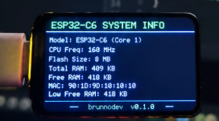

# DevPulse USB

**O PC no painel. A sessão no navegador.**

Um monitor USB aberto com firmware Arduino para ESP32 e agente Python. Acompanhe CPU, RAM e rede em uma tela física; grave uma tarefa e explore a captura no navegador, sem enviar o arquivo a um servidor.

[**Abrir a bancada**](https://brunnojob.github.io/devpulse-usb/) · [Montar o hardware](docs/HARDWARE.md) · [Validação](docs/VALIDATION.md) · [Protocolo](docs/PROTOCOL.md)

[](https://github.com/brunnojob/devpulse-usb/actions/workflows/tests.yml)

<p align="center"></p>

> A foto mostra o protótipo com dados do próprio ESP32. O firmware deste repositório precisa da pinagem e do controlador reais da placa antes da gravação. A bancada e o agente podem ser usados sem hardware.

## Experimente em 60 segundos

Python **3.10+**. No Windows PowerShell:

```powershell
git clone https://github.com/brunnojob/devpulse-usb.git
cd devpulse-usb
python -m venv .venv
.venv\Scripts\Activate.ps1
python -m pip install -r requirements.txt
python agent.py --record sessao.ndjson --duration 60
```

No Linux/macOS, crie o ambiente com `python3 -m venv .venv` e ative com `source .venv/bin/activate`.

Abra `sessao.ndjson` na [bancada](https://brunnojob.github.io/devpulse-usb/#bancada). Selecione **dois arquivos** para sobrepor CPU e comparar duração, média e picos. A média usa o tempo entre leituras; o comparativo não isola a causa de lentidão nem substitui um benchmark controlado.

## O que funciona

- **Coleta local:** CPU, RAM, ocupação do volume escolhido e taxas agregadas de rede.
- **Captura reproduzível:** NDJSON com tempo monotônico relativo; arquivos existentes nunca são sobrescritos.
- **Análise no Pages:** histórico, inspeção por amostra e comparação A/B. O exemplo inicial é explicitamente sintético.
- **USB com recuperação:** porta escolhida pelo usuário, timeout de escrita, reconexão progressiva e enquadramento limitado no firmware.
- **Alertas de uso:** CPU ou RAM em pelo menos 90% durante dez segundos amostrados, com reinício da contagem após lacunas maiores que três segundos.

## Conectar a tela

Confirme o controlador e preencha `firmware/DevPulse/board_config.h` conforme o [guia de hardware](docs/HARDWARE.md). Depois de gravar o firmware:

```sh
python agent.py --list
python agent.py --port COM5 --record trabalho.ndjson --duration 120
```

Troque `COM5` pela porta listada. O monitor serial da IDE deve estar fechado. Sem novos pacotes válidos por cinco segundos, a tela marca os dados como desatualizados.

| Opção | Uso |
| --- | --- |
| `--stdout` | Métricas reais no terminal, sem placa |
| `--record arquivo.ndjson` | Gravação local; pode acompanhar `--port` ou `--stdout` |
| `--duration 60` | Encerra após o período; sem a opção, use Ctrl+C |
| `--interval 0.5` | Intervalo de 0,25 a 2 segundos; padrão 1 |
| `--disk /home` | Volume a medir; padrão: raiz da unidade atual |

## O que está validado

Os testes verificam o agente, cenários de falha serial, o enquadramento C++ e o leitor de sessões. O CI executa o Python em Windows, Linux e macOS. Isso **não comprova funcionamento USB na placa da foto**: identificação, configuração e teste físico continuam pendentes. [Escopo e roteiro de reprodução →](docs/VALIDATION.md)

Sem leitura de GPU, temperatura ou FPS nesta versão. Sem Wi-Fi, serviço de rede ou execução de comandos recebidos do dispositivo. Não há confirmação de entrega dos pacotes. A taxa de rede agrega interfaces; “disco” significa ocupação do volume, não atividade de I/O.

## Desenvolvimento

```sh
python -m unittest discover -s tests -v
npm ci
npm test
npm run format:check
```

[Arquitetura](docs/ARCHITECTURE.md) · [Como contribuir](CONTRIBUTING.md)

Criado por [brunnodev](https://brunnodev.store). Código sob [licença MIT](LICENSE).
